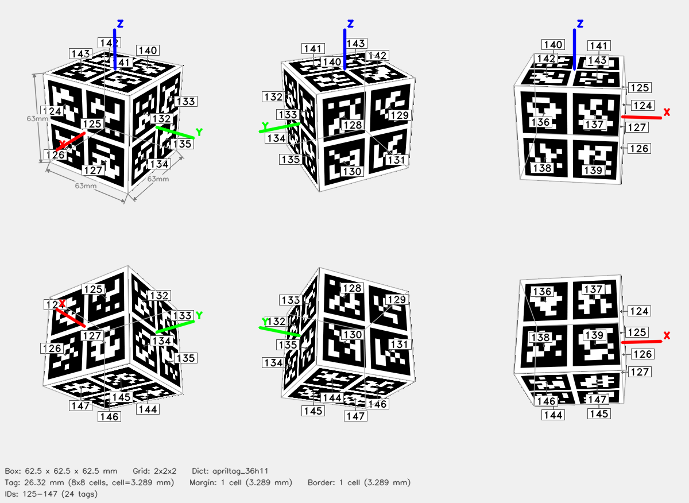

# ArUco Cube — 2x2x2



## Parameters

| Parameter | Value |
|-----------|-------|
| Dictionary | `apriltag_36h11` |
| Grid | 2x2x2 (X x Y x Z tags) |
| Box dimensions | 62.5 x 62.5 x 62.5 mm |
| Tag size | 26.32 mm (8x8 cells) |
| Cell size | 3.289 mm |
| Margin | 1 cell (3.289 mm) |
| Border | 1 cell (3.289 mm) |
| Total tags | 24 |
| Tag IDs | 124–147 |

## Face Layout

| Face | Tag IDs |
|------|---------|
| +X | 125, 124, 127, 126 |
| -X | 129, 128, 131, 130 |
| +Y | 133, 132, 135, 134 |
| -Y | 137, 136, 139, 138 |
| +Z | 142, 143, 140, 141 |
| -Z | 144, 145, 146, 147 |

## Files

| File | Description |
|------|-------------|
| `cube.3mf` | Multi-color 3MF for Bambu Studio |
| `config.json` | Detector config (used by `detect_cube.py`) |
| `thumbnail.png` | 6-view preview |
| `print_a4_tags.pdf` | A4 1:1 printable face-tag sheet |
| `mujoco/cube.xml` | MuJoCo MJCF model |
| `mujoco/cube.obj` | Wavefront OBJ mesh (UV-mapped) |
| `mujoco/cube.mtl` | OBJ material file |
| `mujoco/cube_atlas.png` | Texture atlas |

## Config JSON

```json
{
  "schema_version": 1,
  "target": {
    "type": "cuboid",
    "grid": "2x2x2"
  },
  "dict": "apriltag_36h11",
  "tag_pattern_mirrored": true,
  "grid": "2x2x2",
  "tag_ids": [
    125,
    124,
    127,
    126,
    129,
    128,
    131,
    130,
    133,
    132,
    135,
    134,
    137,
    136,
    139,
    138,
    142,
    143,
    140,
    141,
    144,
    145,
    146,
    147
  ],
  "faces": {
    "+X": [
      125,
      124,
      127,
      126
    ],
    "-X": [
      129,
      128,
      131,
      130
    ],
    "+Y": [
      133,
      132,
      135,
      134
    ],
    "-Y": [
      137,
      136,
      139,
      138
    ],
    "+Z": [
      142,
      143,
      140,
      141
    ],
    "-Z": [
      144,
      145,
      146,
      147
    ]
  },
  "tag_size_mm": 26.315789473684212,
  "cell_size_mm": 3.2894736842105265,
  "margin_cells": 1,
  "border_cells": 1,
  "marker_pixels": 8,
  "box_dims": [
    62.50000000000001,
    62.50000000000001,
    62.50000000000001
  ]
}
```

## Regenerate

```bash
aprilcube generate --grid 2x2x2 --dict apriltag_36h11 --ids 125,124,127,126,129,128,131,130,133,132,135,134,137,136,139,138,142,143,140,141,144,145,146,147 --cell-size 3.2894736842105265 --margin-cell 1 --border-cell 1 -o cube_april_36h11_124_147_2x2x2_outer62p5mm
```
